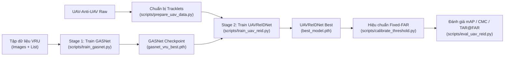

# UAV_ReID — Unified Scientific Research Framework for GASNet & UAV-Anti-UAV ReID

Framework nghiên cứu chuẩn hóa cho bài toán **Aerial / UAV Re-Identification**, hợp nhất toàn bộ quy trình 2 giai đoạn:
1. **Stage 1 (`GASNet`)**: Huấn luyện và đánh giá mạng đặc trưng hình ảnh **GASNet** (`DINOv3-ConvNeXt` / `E-ConvNeXt` + `OSNet` + `BCGG` / `RGA` + `GeM` + `BNNeck`) trên tập dữ liệu **VRU** (hoặc **VRAI**).
2. **Stage 2 (`UAVReIDNet`)**: Kết hợp visual backbone **GASNet** từ Stage 1 với bộ mã hóa chuỗi thời gian (**Temporal Attention** hoặc **Bidirectional Mamba**) và **ReIDHead** (`AttentionPooling` + `BNNeck`) để huấn luyện, hiệu chuẩn ngưỡng (Fixed-FAR Calibration) và đánh giá trên tập **UAV-Anti-UAV**.
3. **Hyperparameter Optimization (HPO / NAS)**: Tích hợp **Optuna** (`TPESampler` + `HyperbandPruner`) tìm kiếm siêu tham số tự động cho cả Stage 1 và Stage 2, xuất trực tiếp file cấu hình tối ưu `best_config.yaml`.

---

## 1. Kiến trúc thư mục

```text
UAV_ReID/
├── configs/
│   ├── gasnet_vru.yaml          # Config chuẩn cho Stage 1 (GASNet trên VRU)
│   ├── uav_reid.yaml            # Config chuẩn cho Stage 2 (UAVReIDNet trên UAV-Anti-UAV)
│   ├── hpo_gasnet.yaml          # Không gian tìm kiếm HPO/NAS cho Stage 1
│   └── hpo_uav_reid.yaml        # Không gian tìm kiếm HPO/NAS cho Stage 2
├── uav_reid/
│   ├── config.py                # Bộ đọc/ghi YAML + ghi đè CLI (--set key.subkey=val)
│   ├── gasnet/
│   │   ├── bcgg.py              # Bottleneck Context Group Gate (BCGG + RepDW deploy fusion)
│   │   └── model.py             # GASNet, DINOv3ConvNeXtBackbone (E-ConvNeXt), OSBlockFS, GeMPool
│   ├── reidnet/
│   │   ├── components.py        # SequencePooler, AttentionPooling, ReIDHead
│   │   ├── temporal_attention.py# TemporalTransformerEncoder (Pre-LN + Sinusoidal PE)
│   │   ├── temporal_mamba.py    # MambaTemporalEncoder (Bidirectional SSM + Residual Gate)
│   │   ├── registry.py          # Registry tạo temporal encoder theo config
│   │   ├── losses.py            # Triplet, LabelSmoothCE, CenterLoss, TemporalConsistencyLoss
│   │   ├── checkpoint.py        # Load checkpoint an toàn & kiểm tra tương thích
│   │   └── model.py             # UAVReIDNet (tích hợp trực tiếp GASNet từ uav_reid.gasnet)
│   ├── datasets/
│   │   ├── vru.py               # VRUDataset & PKBatchSampler
│   │   ├── vrai.py              # VRAITrainDataset & load_vrai_eval
│   │   └── uav_anti_uav.py      # UAVReIDDataset, ReIDBatchSampler, EvalDataset
│   ├── engine/
│   │   ├── gasnet_trainer.py    # Engine train & eval cho Stage 1 (GASNet)
│   │   └── reid_trainer.py      # Engine train 2-stage, Fixed-FAR calibration & eval cho Stage 2
│   ├── search/
│   │   └── optuna_hpo.py        # Optuna TPE + Hyperband Pruner cho Stage 1 & Stage 2
│   └── utils/
│       ├── common.py            # Seed, H100 TF32/BF16, Logger, atomic checkpoint
│       ├── metrics.py           # GPU chunked mAP/CMC (VRU) & mAP/CMC/mINP/TAR@FAR (UAV)
│       └── pipeline_lock.py     # Provenance & pipeline lock chống lệch chuẩn đánh giá
├── scripts/
│   ├── train_gasnet.py          # CLI huấn luyện/đánh giá Stage 1 (GASNet)
│   ├── prepare_uav_data.py      # CLI tiền xử lý dữ liệu UAV-Anti-UAV
│   ├── train_uav_reid.py        # CLI huấn luyện Stage 2 (UAVReIDNet)
│   ├── calibrate_threshold.py   # CLI hiệu chuẩn ngưỡng Fixed-FAR
│   ├── eval_uav_reid.py         # CLI đánh giá độc lập UAVReIDNet
│   ├── run_hpo.py               # CLI chạy Optuna HPO/NAS
│   └── export_onnx.py           # CLI xuất ONNX cho cả GASNet và UAVReIDNet
└── docker/
    ├── Dockerfile               # Docker image tối ưu cho NVIDIA H100 (CUDA 12.1)
    ├── entrypoint.sh            # Entrypoint tự động nhận diện H100/Ampere
    └── run_h100.sh              # Script tự động chạy toàn bộ pipeline trên H100
```

---

## 2. Sơ đồ luồng thực nghiệm (Workflow)



<details>
<summary>📋 Bấm để xem / sao chép mã nguồn Mermaid</summary>

```text
flowchart LR
    vru_data["Tập dữ liệu VRU<br/>(Images + List)"] --> stage1["Stage 1: Train GASNet<br/>(scripts/train_gasnet.py)"]
    stage1 --> gasnet_ckpt["GASNet Checkpoint<br/>(gasnet_vru_best.pth)"]
    uav_raw["UAV-Anti-UAV Raw"] --> prep_data["Chuẩn bị Tracklets<br/>(scripts/prepare_uav_data.py)"]
    prep_data --> stage2["Stage 2: Train UAVReIDNet<br/>(scripts/train_uav_reid.py)"]
    gasnet_ckpt --> stage2
    stage2 --> reid_ckpt["UAVReIDNet Best<br/>(best_model.pth)"]
    reid_ckpt --> calib["Hiệu chuẩn Fixed-FAR<br/>(scripts/calibrate_threshold.py)"]
    calib --> eval_node["Đánh giá mAP / CMC / TAR@FAR<br/>(scripts/eval_uav_reid.py)"]
```

</details>

---

## 3. Hướng dẫn sử dụng từng bước

### Bước 0: Cài đặt môi trường
```bash
cd /home/nvidia/thang/UAV_ReID
pip install -r requirements.txt
```

### Bước 1: Huấn luyện và đánh giá GASNet trên VRU (Stage 1)
Tất cả thông số được quản lý tập trung tại `configs/gasnet_vru.yaml`. Bạn có thể sửa file YAML hoặc ghi đè trực tiếp trên dòng lệnh bằng `--set`:

```bash
# Huấn luyện chuẩn với E-ConvNeXt + BCGG gate trên tập VRU (small/medium/large)
python3 scripts/train_gasnet.py \
    --config configs/gasnet_vru.yaml \
    --set data.root=/path/to/VRU \
    --set data.test_size=small

# Chỉ đánh giá (Eval-only) từ checkpoint đã có
python3 scripts/train_gasnet.py \
    --config configs/gasnet_vru.yaml \
    --eval-only \
    --checkpoint outputs/gasnet_vru/gasnet_vru_best.pth
```

### Bước 2: Tiền xử lý dữ liệu UAV-Anti-UAV (Nếu chưa tạo `reid_dataset`)
```bash
python3 scripts/prepare_uav_data.py \
    --data-root /path/to/raw_uav_anti_uav \
    --output-dir /path/to/reid_dataset \
    --workers 8
```

### Bước 3: Huấn luyện UAVReIDNet kết hợp GASNet (Stage 2)
Mô hình `UAVReIDNet` tự động nạp checkpoint `gasnet_vru_best.pth` từ Stage 1 (tự động nhận diện `bcgg` hoặc `rga` gate và kiến trúc `E-ConvNeXt`), thực hiện huấn luyện 2 pha:
* **Pha 1 (`stage1_epochs`)**: Đóng băng GASNet, huấn luyện Temporal Encoder (`attention` hoặc `mamba`) + `ReIDHead`.
* **Pha 2 (`stage2_epochs`)**: Tải lại `best_model.pth` của Pha 1, mở khóa GASNet với discriminative learning rate (`1e-5` cho pretrained backbone, `1e-4` cho nhánh E-ConvNeXt mới) và cố định `BatchNorm2d` affine.

```bash
python3 scripts/train_uav_reid.py \
    --config configs/uav_reid.yaml \
    --set data.data_root=/path/to/reid_dataset \
    --set model.gasnet_weights=outputs/gasnet_vru/gasnet_vru_best.pth \
    --set model.temporal_name=attention
```
*(Để đổi sang Mamba, chỉ cần thêm `--set model.temporal_name=mamba`)*.

### Bước 4: Hiệu chuẩn ngưỡng Fixed-FAR & Đánh giá cuối cùng
```bash
# 1. Hiệu chuẩn ngưỡng quyết định trên tập Val ở các mức FAR (1%, 5%, 10%)
python3 scripts/calibrate_threshold.py \
    --config configs/uav_reid.yaml \
    --checkpoint outputs/uav_reid/best_model.pth

# 2. Đánh giá trên tập Test sử dụng ngưỡng vừa hiệu chuẩn
python3 scripts/eval_uav_reid.py \
    --config configs/uav_reid.yaml \
    --checkpoint outputs/uav_reid/best_model.pth \
    --split test
```

---

## 4. Tìm kiếm siêu tham số tự động (HPO / NAS với Optuna)

Hệ thống sử dụng **Optuna** (`TPESampler` đa biến kết hợp `HyperbandPruner` để dừng sớm các cấu hình kém triển vọng).

### Tìm siêu tham số cho Stage 1 (GASNet):
```bash
python3 scripts/run_hpo.py \
    --config configs/gasnet_vru.yaml \
    --hpo-config configs/hpo_gasnet.yaml \
    --n-trials 20
```
* Không gian tìm kiếm (`configs/hpo_gasnet.yaml`): `backbone_lr`, `head_lr`, `weight_decay`, `label_smoothing`, `triplet_margin`, `dropout_rate`, `gem_p`, `gate_reduction`, `gate_groups`, `prob_erasing`.

### Tìm siêu tham số cho Stage 2 (UAVReIDNet):
```bash
python3 scripts/run_hpo.py \
    --config configs/uav_reid.yaml \
    --hpo-config configs/hpo_uav_reid.yaml \
    --n-trials 20
```
* Không gian tìm kiếm (`configs/hpo_uav_reid.yaml`): `temporal_name` (`attention` vs `mamba`), `temporal_layers`, `temporal_dropout`, `lr`, `stage2_backbone_lr`, `triplet_margin`, `center_loss_weight`, `temp_cons_weight`, `random_erasing`.
* Kết quả tốt nhất được lưu tự động tại `outputs/hpo_*/best_config.yaml` và database SQLite (`optuna_*.db`) để có thể tiếp tục chạy (`resume`) bất kỳ lúc nào.

---

## 5. Hướng dẫn chạy trên Server NVIDIA H100 (80GB)

Codebase đã được thiết kế sẵn để tận dụng tối đa phần cứng **NVIDIA H100**:
* Tự động kích hoạt **TF32** (`allow_tf32 = True`) cho phép nhân ma trận Tensor Core.
* Tự động chọn **BF16 Mixed Precision** (`torch.bfloat16`) trên kiến trúc Hopper/Ampere để tránh tràn số gradient.
* Hỗ trợ **`torch.compile(mode="reduce-overhead")`** khi bật `--set runtime.compile=true`.
* Cho phép tăng `batch_size` lớn trên 80GB VRAM (`P=32, K=8` ở Stage 1; `P=16, K=4, seq_len=16` ở Stage 2).

### Cách 1: Chạy trực tiếp trên Server H100 (Bare-metal / Conda / Slurm)
Sử dụng script tự động `docker/run_h100.sh`:

```bash
export VRU_ROOT=/path/to/VRU
export UAV_ROOT=/path/to/reid_dataset

# Chạy toàn bộ quy trình (Stage 1 -> Stage 2 -> Calibrate -> Eval)
bash docker/run_h100.sh full

# Hoặc chạy từng phần:
bash docker/run_h100.sh stage1      # Chỉ chạy Stage 1 (GASNet)
bash docker/run_h100.sh stage2      # Chỉ chạy Stage 2 (UAVReIDNet)
bash docker/run_h100.sh hpo_stage2  # Chạy tìm kiếm siêu tham số trên H100
```

### Cách 2: Chạy bằng Docker trên Server H100 (Hỗ trợ Offline / No-Internet)
Khi chạy trên cụm H100 không có kết nối mạng ra ngoài, bạn có thể tải trước weights DINOv3 về thư mục `pretrained_cache/` rồi mount vào container:

```bash
# 1. Build Docker image
docker build -t uav_reid:h100 -f docker/Dockerfile .

# 2. Chạy container với GPU H100
docker run --gpus all --rm -it \
    --shm-size=32g \
    -v /path/to/VRU:/data/VRU:ro \
    -v /path/to/reid_dataset:/data/uav_reid_dataset:ro \
    -v $(pwd)/outputs:/workspace/UAV_ReID/outputs \
    uav_reid:h100 \
    bash docker/run_h100.sh full
```
